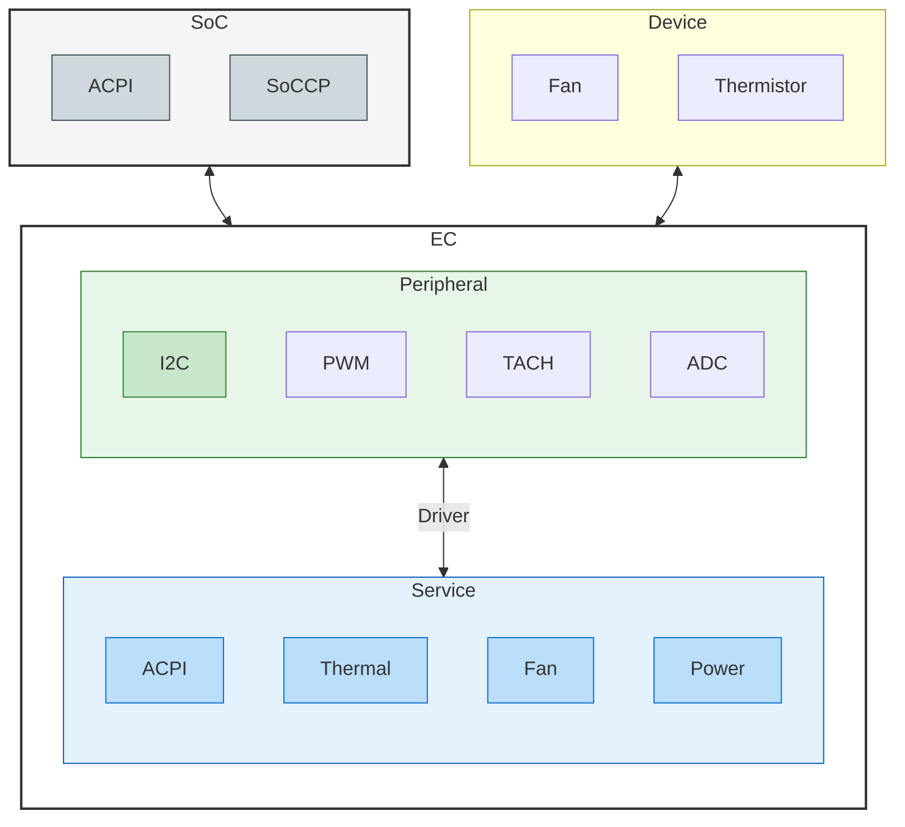

# EC Firmware For Qualcomm

## 1. System Architecture Diagram

## 2. Directory Responsibilities

App 與 bootloader 共用 repository 根目錄下的 interface / driver / service，
`CONFIG_APP_BOOTLOADER` (於 `bootloader/prj.conf` 啟用) 用來選擇 bootloader 專屬元件。

### 📂 `interface/` (Interface Layer)
Driver 與 service 共用的 API 定義。`acpi.h`、`storage.h` 中 bootloader 專屬的
部分 (buffer 大小、image header) 以 `CONFIG_APP_BOOTLOADER` 區分。

### 📂 `service/` (Core Logic Layer)
ACPI service 由兩者共用；`ec_fw_update_bootloader.c` 與 `flash/` 僅 bootloader 使用，
SCI、Fan、Thermal、Power、SoCCP 等 service 僅 app 使用。

### 📂 `driver/` (Driver Layer / Infrastructure)
`acpi.c` (I2C target) 與 QEMU 用的 `simulator.c` 由兩者共用；`flash.c` 與
`storage_bootloader.c` 僅 bootloader 使用，其餘周邊 driver 僅 app 使用。
