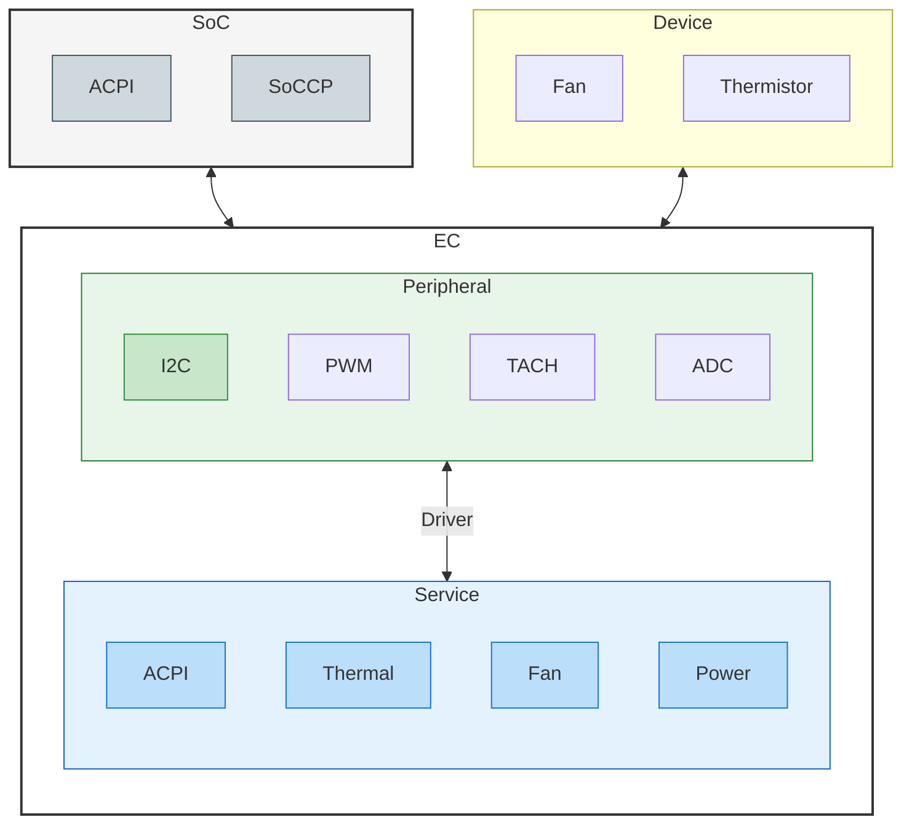

# EC Firmware For Qualcomm

## 1. System Architecture Diagram

## 2. Directory Responsibilities

The app and bootloader share their interfaces, drivers, and services from the
repository root. `CONFIG_EC_BOOTLOADER` selects bootloader-only components.

### 📂 `interface/` (Shared Interface Layer)
Public APIs used by the shared drivers and services.

### 📂 `service/` (Shared and App Services)
ACPI command handling is shared; SCI event queueing is provided by the separate
`service/sci` service. Fan, thermal, power, and SoCCP services are app-only.

### 📂 `driver/` (Shared and App Drivers)
Shared ACPI and storage drivers plus app-only peripheral drivers. Bootloader
flash and image-validation implementations are selected by
`CONFIG_EC_BOOTLOADER`.
