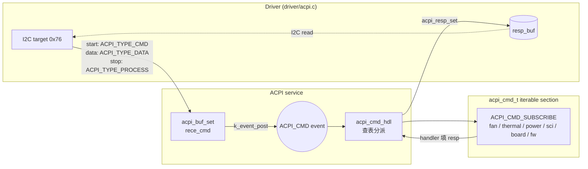

# ACPI service

中文 | [English](readme_en.md)

接收 Host (SoC) 經 I2C target (位址 `0x76`) 送來的 ACPI 命令，依命令表分派給各 service 的 handler，
並把 response 寫回 interface buffer 供 Host 讀取。App 與 bootloader 共用此 service，
但註冊的命令不同 (見 [命令表](#命令表))。

## Kconfig
| Option | Default | 說明 |
| --- | --- | --- |
| `CONFIG_ACPI_SERVICE` | y | 啟用 ACPI service |
| `CONFIG_ACPI_LOG_LEVEL` | - | log level |
| `CONFIG_ACPI_SHELL` | y (需 `SHELL`) | `acpi` shell 命令 |

Buffer 大小定義在 [interface/acpi.h](../../interface/acpi.h)：

| | `ACPI_RECE_LEN` | `ACPI_RESP_LEN` |
| --- | --- | --- |
| App | 512 | 64 |
| Bootloader (`CONFIG_APP_BOOTLOADER`) | 1024 | 1024 (0xA0 / 0xA1 需 512B payload) |

## Architecture


### 接收與分派流程
1. `ACPI_TYPE_CMD` (I2C 寫入的第一個 byte)：清空 index，存入 opcode，並從命令表查出該命令的 `mand`。
2. `ACPI_TYPE_DATA`：依序存入 `rece_cmd`。收到的 byte 數 **等於 `mand`** 時立即觸發分派，
   讓 Host 不送 stop 直接 repeated-start 讀取也能拿到 response。
3. 若在提前分派後又收到 optional payload，會標記為未分派；
   `ACPI_TYPE_PROCESS` (I2C stop) 時再分派一次，讓 handler 看到完整命令。
4. Service thread (`APP_PRIO_H`) 在 `acpi_cmd_t` section 中找到 opcode，
   當 `cmd_len >= mand` 時呼叫 handler；長度不足時不會呼叫 handler。
5. App：handler 成功後由 service 呼叫 `acpi_resp_set(resp_buf, resp_len)`。
   Bootloader：handler 自行呼叫 `acpi_resp_set` (response 長度可變)。

### 新增命令
在任一 service 中使用 [interface/acpi.h](../../interface/acpi.h) 的 macro：

```c
// ACPI_CMD_SUBSCRIBE(name, opcode, handler, mand, opt, resp_len)
ACPI_CMD_SUBSCRIBE(fan, EC_FAN_RPM, acpi_ec_fan_rpm, 2, 0, 3);
```

| 參數 | 說明 |
| --- | --- |
| `mand` | 必要 byte 數，**包含 opcode** |
| `opt` | opcode 之後的 optional byte 數；慣例上 `cmd_len == mand + opt` 視為寫入 (set)，否則為讀取 (get) |
| `resp_len` | response 長度 (含 byte count，若有) |

Handler 內使用 [acpi_tbl.h](acpi_tbl.h) 的 `ACPI_CHECK_IN` / `ACPI_CHECK_OUT` 檢查輸入/輸出長度。
命令 opcode 也統一定義在 `acpi_tbl.h`。

## 命令表

`cmd` 欄位為 Host 寫入的完整 byte 序列 (`[]` 為 optional)，`resp` 為 Host 讀回的內容。

### App
| Opcode | 名稱 | 檔案 | cmd | resp |
| --- | --- | --- | --- | --- |
| 0x05 | Active cooling SCI event | [sci](../sci/service.c) | `05` | `sci` (讀取後清除) |
| 0x06 | Device ID | [ec_ver_and_cap.c](ec_ver_and_cap.c) | `06` | `02 34 12` |
| 0x0E | FW version | ec_ver_and_cap.c | `0E` | `03 test sub major` |
| 0x0F | FW version + lowest supported | ec_ver_and_cap.c | `0F` | `07 ver(3) lowest(3) 'A'` |
| 0x42 | Thermal capabilities | ec_ver_and_cap.c | `42 02` | `02 82 FC` |
| 0x43 | ACPI who-am-i | ec_ver_and_cap.c | `43` | `01` |
| 0x44 | Active cooling IF ver & caps | ec_ver_and_cap.c | `44` | `05 FF 3F 00 00 11` |
| 0x20 ~ 0x30 | Fan 相關 | [fan](../fan/readme.md) | | |
| 0x23 | Modern standby notify | [power](../power/readme.md) | `23 status` | - |
| 0x29 ~ 0x34 | Thermistor 相關 | [thermal](../thermal/readme.md) | | |
| 0x35 | EC function flags | [ec_act_cool.c](ec_act_cool.c) | `35 [08 flags(8)]` | `08 flags(8)`；bit0 = SCI enable |
| 0xBB | SPI services | [ec_fw_update.c](ec_fw_update.c) | `BB 01 sub` | - |
| 0xEC | EC state & WP status | ec_fw_update.c | `EC` | `02 state path` |

App 端 0xBB 只支援：
- `0xDC` Enter bootloader：boot info 設為 `EC_BOOT_MODE_STAY_IN_BBK` 並儲存，100 ms 後跳到 bootloader。
- `0x33` Exit bootloader：已在 main block，不動作。

`0xB0` (flashing capabilities) 目前未支援。

### Bootloader ([ec_fw_update_bootloader.c](ec_fw_update_bootloader.c))
| Opcode | 名稱 | cmd | resp |
| --- | --- | --- | --- |
| 0xEB | FW corruption status | `EB` | `01 status` |
| 0xEC | EC state & WP status | `EC` | `02 state path` |
| 0xA2 | Read CRC result | `A2` | `05 status(AC/FA) crc(4B LE, CRC8 於 LSB)` |
| 0xAE | Erase region | `AE 05 path blk addr(3)` | - |
| 0xAF | Quick erase partition | `AF 01 sub` | - |
| 0xA0 | Write RAM buffer | `A0 data(512)` | - |
| 0xAA | Commit RAM buffer to flash | `AA 05 path size/32 addr(3)` | - |
| 0xA7 | Read region to RAM buffer | `A7 04 path addr(3)` | - |
| 0xA1 | Read RAM buffer | `A1` | `data(512)` |
| 0xBB | SPI services | `BB 01 sub` | - |

補充：
- Flash control path：`0x4F` internal、`0x0F` external (不支援)、`0xEA` auto
  (0xAA 使用 0xAF 設定、每次 commit 後自動遞增的寫入位址)。
- `0xAE` 與 `0xAA` (path `0x4F`) 會在 Host 位址上加 `0x9000` 對齊實際 flash 位址；`0xA7` 直接使用 Host 位址。
- `0xAE` 的 `blk` 以 4 KB 為單位；`0xAA` 的 `size` 以 32 bytes 為單位，且不超過上次 0xA0 寫入的長度。
- `0xA0` 的 `mand` 為 513，必須送滿 512 bytes 才會執行。
- `0xAF` 目前只支援 `0x21` (erase backup main，`CONFIG_BOARD_QC_MODULE`)，其餘 sub-command 只印 log。
- 所有 flash 操作透過 [flash service](../flash/readme.md) 執行。

0xBB sub-command：
| Sub | 功能 |
| --- | --- |
| `0xDC` / `0x33` | Enter / exit bootloader (exit 前驗證 image header，失敗則留在 bootloader) |
| `0xCC` | Cold reboot |
| `0xC0` / `0xC1` / `0xC2` | 強制 crash：kernel oops / assert / watchdog hang (測試用) |
| `0x11` ~ `0x13` | Code mirror (僅 log) |
| `0x15` ~ `0x1C` | FW sync (僅 log) |
| `0xF0` | 對 internal active main 計算 CRC，結果存入 boot info，由 0xA2 讀取 |
| `0xF1` ~ `0xF9` | 其他 partition CRC (未支援) |

典型 FW update 流程：
```
BB 01 DC                 # (App) 進入 bootloader
EC                       # 確認 state
AF 01 21                 # 抹除 main partition，設定 auto 寫入位址
A0 <512 bytes>           # 重複：寫入 RAM buffer
AA 05 EA 10 00 00 00     #       commit 512 bytes (0x10 * 32) 到 auto 位址
BB 01 F0                 # 計算 CRC
A2                       # 讀 CRC 結果 (0xAC = passed)
BB 01 33                 # 離開 bootloader
```

## Shell
| 命令 | 說明 |
| --- | --- |
| `acpi write <op> [data ...]` | 以 hex 模擬 Host 寫入命令，結束時送出 `ACPI_TYPE_PROCESS` (等同 I2C stop) |

Shell 沒有讀取 response 的命令，需搭配 log 或由 Host 端讀回確認。
`ec_fw_update_bootloader.c` 內的 `fw_update` shell 受 `CONFIG_FW_UPDATE_SHELL` 控制，
該 option 目前沒有在任何 Kconfig 中定義，因此不會編入。

## Test
```shell
uart:~$ acpi write 0x0E
ACPI CMD written successfully
# Host 讀回: 03 01 01 01

uart:~$ acpi write 0x42 0x02
ACPI CMD written successfully
# Host 讀回: 02 82 FC

uart:~$ acpi write 0x35 0x08 0x01 0 0 0 0 0 0 0
ACPI CMD written successfully
# 啟用 SCI，Host 讀回: 08 01 00 00 00 00 00 00 00
```

將 `CONFIG_ACPI_LOG_LEVEL_DBG=y` 可看到 `Handled ACPI cmd 0x.. successfully`。
