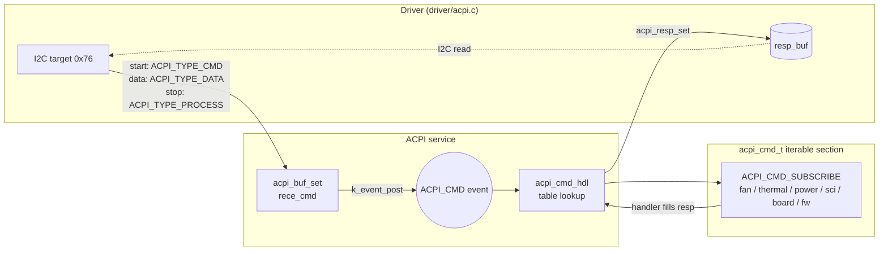

# ACPI service

[中文](readme.md) | English

Receives ACPI commands sent by the host (SoC) through the I2C target (address `0x76`), dispatches them
to the handlers registered by each service, and writes the response back to the interface buffer for
the host to read. The service is shared by the app and the bootloader, but each registers a different
set of commands (see [Command table](#command-table)).

## Kconfig
| Option | Default | Description |
| --- | --- | --- |
| `CONFIG_ACPI_SERVICE` | y | Enable the ACPI service |
| `CONFIG_ACPI_LOG_LEVEL` | - | Log level |
| `CONFIG_ACPI_SHELL` | y (requires `SHELL`) | `acpi` shell commands |

Buffer sizes are defined in [interface/acpi.h](../../interface/acpi.h):

| | `ACPI_RECE_LEN` | `ACPI_RESP_LEN` |
| --- | --- | --- |
| App | 512 | 64 |
| Bootloader (`CONFIG_APP_BOOTLOADER`) | 1024 | 1024 (0xA0 / 0xA1 carry 512 B payloads) |

## Architecture


### Receive and dispatch flow
1. `ACPI_TYPE_CMD` (first byte of an I2C write): resets the index, stores the opcode, and looks up the
   command's `mand` in the command table.
2. `ACPI_TYPE_DATA`: bytes are appended to `rece_cmd`. As soon as the byte count **equals `mand`**, the
   command is dispatched, so the response is ready even if the host reads with a repeated start instead
   of sending a stop.
3. If optional payload arrives after that early dispatch, the command is marked as not dispatched, and
   `ACPI_TYPE_PROCESS` (I2C stop) dispatches it again so the handler sees the complete command.
4. The service thread (`APP_PRIO_H`) looks up the opcode in the `acpi_cmd_t` section and calls the
   handler when `cmd_len >= mand`. If the command is too short, the handler is not called.
5. App: after the handler succeeds, the service calls `acpi_resp_set(resp_buf, resp_len)`.
   Bootloader: handlers call `acpi_resp_set` themselves (the response length varies).

### Adding a command
Use the macro from [interface/acpi.h](../../interface/acpi.h) in any service:

```c
// ACPI_CMD_SUBSCRIBE(name, opcode, handler, mand, opt, resp_len)
ACPI_CMD_SUBSCRIBE(fan, EC_FAN_RPM, acpi_ec_fan_rpm, 2, 0, 3);
```

| Parameter | Description |
| --- | --- |
| `mand` | Number of mandatory bytes, **including the opcode** |
| `opt` | Number of optional bytes after the opcode. By convention, `cmd_len == mand + opt` is a write (set), anything else is a read (get) |
| `resp_len` | Response length (including the byte count, if any) |

Inside a handler, use `ACPI_CHECK_IN` / `ACPI_CHECK_OUT` from [acpi_tbl.h](acpi_tbl.h) to validate
input and output lengths. Command opcodes are also defined in `acpi_tbl.h`.

## Command table

The `cmd` column is the full byte sequence written by the host (`[]` is optional), and `resp` is what
the host reads back.

### App
| Opcode | Name | File | cmd | resp |
| --- | --- | --- | --- | --- |
| 0x05 | Active cooling SCI event | [sci](../sci/service.c) | `05` | `sci` (cleared on read) |
| 0x06 | Device ID | [ec_ver_and_cap.c](ec_ver_and_cap.c) | `06` | `02 34 12` |
| 0x0E | FW version | ec_ver_and_cap.c | `0E` | `03 test sub major` |
| 0x0F | FW version + lowest supported | ec_ver_and_cap.c | `0F` | `07 ver(3) lowest(3) 'A'` |
| 0x42 | Thermal capabilities | ec_ver_and_cap.c | `42 02` | `02 82 FC` |
| 0x43 | ACPI who-am-i | ec_ver_and_cap.c | `43` | `01` |
| 0x44 | Active cooling IF ver & caps | ec_ver_and_cap.c | `44` | `05 FF 3F 00 00 11` |
| 0x20 ~ 0x30 | Fan commands | [fan](../fan/readme_en.md) | | |
| 0x23 | Modern standby notify | [power](../power/readme_en.md) | `23 status` | - |
| 0x29 ~ 0x34 | Thermistor commands | [thermal](../thermal/readme_en.md) | | |
| 0x35 | EC function flags | [ec_act_cool.c](ec_act_cool.c) | `35 [08 flags(8)]` | `08 flags(8)`; bit0 = SCI enable |
| 0xBB | SPI services | [ec_fw_update.c](ec_fw_update.c) | `BB 01 sub` | - |
| 0xEC | EC state & WP status | ec_fw_update.c | `EC` | `02 state path` |

On the app side, 0xBB supports only:
- `0xDC` Enter bootloader: sets boot info to `EC_BOOT_MODE_STAY_IN_BBK`, saves it, and jumps to the
  bootloader after 100 ms.
- `0x33` Exit bootloader: already in the main block, does nothing.

`0xB0` (flashing capabilities) is not supported yet.

### Bootloader ([ec_fw_update_bootloader.c](ec_fw_update_bootloader.c))
| Opcode | Name | cmd | resp |
| --- | --- | --- | --- |
| 0xEB | FW corruption status | `EB` | `01 status` |
| 0xEC | EC state & WP status | `EC` | `02 state path` |
| 0xA2 | Read CRC result | `A2` | `05 status(AC/FA) crc(4B LE, CRC8 in LSB)` |
| 0xAE | Erase region | `AE 05 path blk addr(3)` | - |
| 0xAF | Quick erase partition | `AF 01 sub` | - |
| 0xA0 | Write RAM buffer | `A0 data(512)` | - |
| 0xAA | Commit RAM buffer to flash | `AA 05 path size/32 addr(3)` | - |
| 0xA7 | Read region into RAM buffer | `A7 04 path addr(3)` | - |
| 0xA1 | Read RAM buffer | `A1` | `data(512)` |
| 0xBB | SPI services | `BB 01 sub` | - |

Notes:
- Flash control path: `0x4F` internal, `0x0F` external (not supported), `0xEA` auto
  (0xAA uses the write address set by 0xAF, which advances after each commit).
- `0xAE` and `0xAA` (path `0x4F`) add `0x9000` to the host address to match the actual flash address;
  `0xA7` uses the host address as is.
- The `blk` field of `0xAE` is in 4 KB units; the `size` field of `0xAA` is in 32-byte units and is
  capped at the length written by the last 0xA0.
- `0xA0` has `mand` = 513, so it only runs once the full 512 bytes are received.
- `0xAF` currently supports only `0x21` (erase backup main, `CONFIG_BOARD_QC_MODULE`); other
  sub-commands only log.
- All flash operations go through the [flash service](../flash/readme_en.md).

0xBB sub-commands:
| Sub | Function |
| --- | --- |
| `0xDC` / `0x33` | Enter / exit bootloader (exit validates the image header first and stays in the bootloader on failure) |
| `0xCC` | Cold reboot |
| `0xC0` / `0xC1` / `0xC2` | Forced crash: kernel oops / assert / watchdog hang (for testing) |
| `0x11` ~ `0x13` | Code mirror (log only) |
| `0x15` ~ `0x1C` | FW sync (log only) |
| `0xF0` | Compute CRC of internal active main, store the result in boot info, read it back with 0xA2 |
| `0xF1` ~ `0xF9` | CRC of other partitions (not supported) |

Typical FW update sequence:
```
BB 01 DC                 # (App) enter bootloader
EC                       # check state
AF 01 21                 # erase main partition, set auto write address
A0 <512 bytes>           # repeat: write RAM buffer
AA 05 EA 10 00 00 00     #         commit 512 bytes (0x10 * 32) to the auto address
BB 01 F0                 # compute CRC
A2                       # read CRC result (0xAC = passed)
BB 01 33                 # exit bootloader
```

## Shell
| Command | Description |
| --- | --- |
| `acpi write <op> [data ...]` | Simulate a host write in hex; sends `ACPI_TYPE_PROCESS` at the end (same as an I2C stop) |

The shell has no command to read the response; check the log or read it back from the host.
The `fw_update` shell in `ec_fw_update_bootloader.c` is guarded by `CONFIG_FW_UPDATE_SHELL`, which is
not defined in any Kconfig yet, so it is never compiled in.

## Test
```shell
uart:~$ acpi write 0x0E
ACPI CMD written successfully
# Host reads back: 03 01 01 01

uart:~$ acpi write 0x42 0x02
ACPI CMD written successfully
# Host reads back: 02 82 FC

uart:~$ acpi write 0x35 0x08 0x01 0 0 0 0 0 0 0
ACPI CMD written successfully
# SCI enabled, host reads back: 08 01 00 00 00 00 00 00 00
```

Set `CONFIG_ACPI_LOG_LEVEL_DBG=y` to see `Handled ACPI cmd 0x.. successfully`.
