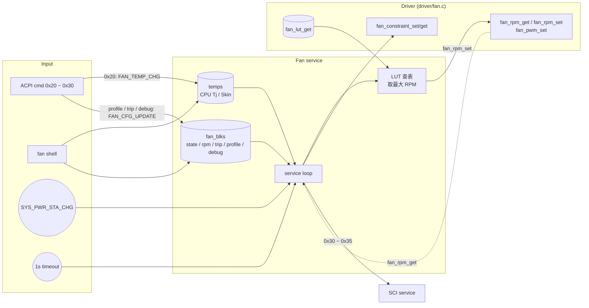

# Fan service

中文 | [English](readme_en.md)

依 SoC 提供的溫度與 fan profile 的 LUT 計算目標 RPM 控制風扇，監控實際 RPM，
並在狀態改變或超出 trip point 時送出 SCI 通知 Host。僅編入 app。

## Kconfig
| Option | Default | 說明 |
| --- | --- | --- |
| `CONFIG_FAN_SERVICE` | y | 啟用 Fan service |
| `CONFIG_FAN_LOG_LEVEL` | - | log level |
| `CONFIG_FAN_SHELL` | y (需 `SHELL`) | `fan` shell 命令 |

## Architecture


### Service loop
Thread 在系統事件 (power state change)、`FAN_TEMP_CHG`、`FAN_CFG_UPDATE` 或每 1 秒逾時時醒來，對每個 fan：

1. 由 driver 讀實際 RPM。RPM 由 0 變為非 0 (或相反) 時更新 `state` 並送 SCI `0x30` / `0x31`。
2. RPM 低於 `trip_low` 或高於 `trip_high` 時送 SCI `0x32` / `0x33` (在範圍外期間每次 loop 都會送)。
3. Debug mode (`dbg_mode` bit0) 啟用時直接套用 debug 設定，略過後續步驟。
4. Power state：非 S0 時把 fan constraint 設為 OFF 並略過；回到 S0 時把 constraint 設回 ON。
5. 查 LUT：溫度取整數 °C，找出 `temp_low < T <= temp_high` 的 entry，
   取 CPU Tj 與 Skin 兩個 LUT 中最大的 RPM (`rpm * 100`)，呼叫 `fan_rpm_set`。

開機預設 profile 為 `6` (best performance, charger in)。預設 trip point：Fan1 `0 ~ 10000`、Fan2 `0 ~ 12000` RPM。

### 定義
| 項目 | 值 |
| --- | --- |
| Fan ID | `1`, `2` |
| 溫度來源 | `1` CPU Tj、`2` Skin；單位 0.1 °C |
| Fan state | `0` OFF、`1` ON、`2` Failure |
| Profile | `1` battery saver、`2`/`3` better battery (charger in/out)、`4`/`5` better performance (in/out)、`6`/`7` best performance (in/out) |
| LUT entry | 3 bytes：`rpm/100`, `temp_high`, `temp_low`；每個 LUT 最多 10 筆 |
| Debug mode | bit0 debug ON、bit1 fan ON、bit2 type (0: RPM, 1: PWM) |

## ACPI 命令
`[]` 內為 optional；帶 optional 欄位即為寫入，否則為讀取。

| Opcode | 名稱 | cmd | resp |
| --- | --- | --- | --- |
| 0x20 | SoC to EC temp | `20 src 02 tempL tempH` | - |
| 0x21 | Fan status | `21 fan` | `state` |
| 0x22 | Fan RPM | `22 fan` | `02 rpmL rpmH` |
| 0x24 | Fan profile | `24 [fan<<4 \| profile]` | `profile` |
| 0x25 | Fan trip point | `25 fan [04 lowL lowH highL highH]` | `04 lowL lowH highL highH` |
| 0x26 | Fan profile number | `26 fan` | `07` |
| 0x27 | Fan LUT number | `27 profile<<4 \| fan` | `LUT 數 - 1` |
| 0x28 | Fan LUT | `28 profile<<4 \| fan src [N*3 data...]` | `N*3 data...` |
| 0x30 | Fan debug control | `30 fan [04 mode rpmL rpmH pwm]` | `04 mode rpmL rpmH pwm` |

補充：
- 0x24 寫入時 fan 為 0 視為 fan 1，會重新載入 LUT 並送 SCI `0x35`；讀取固定回報 fan 1 的 profile。
- 0x28 寫入會送 SCI `0x34`。
- 0x23 (modern standby) 由 [power service](../power/readme.md) 處理；0x05 / 0x35 由 [SCI](../sci/readme.md) / [ACPI](../acpi/readme.md) 處理。

## SCI
| SCI | 觸發條件 |
| --- | --- |
| `0x30` / `0x31` | Fan1 / Fan2 ON/OFF 狀態改變 |
| `0x32` / `0x33` | Fan1 / Fan2 RPM 超出 trip point |
| `0x34` | LUT 被寫入 (0x28) |
| `0x35` | Fan profile 切換 (0x24) |

## Shell
| 命令 | 說明 |
| --- | --- |
| `fan dump` | 顯示所有 fan 資訊 |
| `fan get <id>` | 顯示單一 fan (含 LUT、constraint、debug、溫度) |
| `fan temp <src> <0.1C>` | 設定溫度來源 (`1` CPU、`2` Skin)，例：`350` = 35.0 °C |
| `fan state <id> <state>` | 設定 state |
| `fan trip <id> <low> <high>` | 設定 trip point (RPM) |
| `fan profile <id> <1~7>` | 切換 profile 並重新載入 LUT |
| `fan constraint [0\|1]` | 讀取/設定 SoC-CP fan constraint |
| `fan debug <id> <mode> [val]` | 設定 debug mode；`val` 依 bit2 為 RPM 或 PWM |

## Test
```shell
uart:~$ fan temp 1 650
Fan ID: 1, tmp set to: 65.0 C
uart:~$ fan get 1
Fan ID: 1
Fan state: 1
Fan rpm: ...
...
temp[1]: 650, temp[2]: 0

uart:~$ fan profile 1 1
Fan 1 profile updated to 1

uart:~$ fan debug 1 0x03 3000
Fan 1 debug mode: 0x03 updated     # debug ON, fan ON, 固定 3000 RPM
uart:~$ fan debug 1 0x07 128
Fan 1 debug mode: 0x07 updated     # debug ON, fan ON, PWM 128
uart:~$ fan debug 1 0
Fan 1 debug mode: 0x00 updated     # 回到 LUT 控制

uart:~$ acpi write 0x22 0x01
ACPI CMD written successfully
# Host 讀回: 02 rpmL rpmH
```
