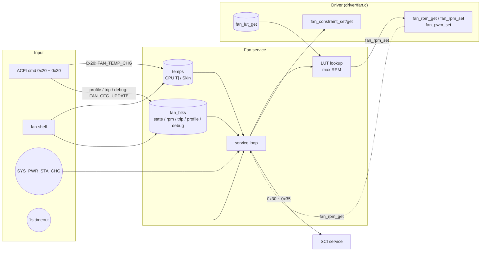

# Fan service

[中文](readme.md) | English

Computes the target RPM from the temperatures reported by the SoC and the LUT of the active fan
profile, drives the fans, monitors the actual RPM, and sends SCI notifications to the host when the
fan state changes or the RPM leaves the trip range. App only.

## Kconfig
| Option | Default | Description |
| --- | --- | --- |
| `CONFIG_FAN_SERVICE` | y | Enable the Fan service |
| `CONFIG_FAN_LOG_LEVEL` | - | Log level |
| `CONFIG_FAN_SHELL` | y (requires `SHELL`) | `fan` shell commands |

## Architecture


### Service loop
The thread wakes on a system event (power state change), `FAN_TEMP_CHG`, `FAN_CFG_UPDATE`, or a
1-second timeout. For each fan it:

1. Reads the actual RPM from the driver. When the RPM goes from 0 to non-zero (or back), it updates
   `state` and sends SCI `0x30` / `0x31`.
2. Sends SCI `0x32` / `0x33` when the RPM is below `trip_low` or above `trip_high` (sent on every pass
   while out of range).
3. If debug mode (`dbg_mode` bit0) is on, applies the debug settings and skips the remaining steps.
4. Power state: outside S0, sets the fan constraint to OFF and skips; back in S0, sets it to ON again.
5. LUT lookup: the temperature is truncated to whole °C, the entry with `temp_low < T <= temp_high` is
   selected, and the highest RPM (`rpm * 100`) across the CPU Tj and Skin LUTs is passed to `fan_rpm_set`.

The default profile at boot is `6` (best performance, charger in). Default trip points: Fan1
`0 ~ 10000`, Fan2 `0 ~ 12000` RPM.

### Definitions
| Item | Value |
| --- | --- |
| Fan ID | `1`, `2` |
| Temperature source | `1` CPU Tj, `2` Skin; unit 0.1 °C |
| Fan state | `0` OFF, `1` ON, `2` Failure |
| Profile | `1` battery saver, `2`/`3` better battery (charger in/out), `4`/`5` better performance (in/out), `6`/`7` best performance (in/out) |
| LUT entry | 3 bytes: `rpm/100`, `temp_high`, `temp_low`; up to 10 entries per LUT |
| Debug mode | bit0 debug ON, bit1 fan ON, bit2 type (0: RPM, 1: PWM) |

## ACPI commands
Fields in `[]` are optional; including them makes the command a write, otherwise it is a read.

| Opcode | Name | cmd | resp |
| --- | --- | --- | --- |
| 0x20 | SoC to EC temp | `20 src 02 tempL tempH` | - |
| 0x21 | Fan status | `21 fan` | `state` |
| 0x22 | Fan RPM | `22 fan` | `02 rpmL rpmH` |
| 0x24 | Fan profile | `24 [fan<<4 \| profile]` | `profile` |
| 0x25 | Fan trip point | `25 fan [04 lowL lowH highL highH]` | `04 lowL lowH highL highH` |
| 0x26 | Fan profile number | `26 fan` | `07` |
| 0x27 | Fan LUT number | `27 profile<<4 \| fan` | `number of LUTs - 1` |
| 0x28 | Fan LUT | `28 profile<<4 \| fan src [N*3 data...]` | `N*3 data...` |
| 0x30 | Fan debug control | `30 fan [04 mode rpmL rpmH pwm]` | `04 mode rpmL rpmH pwm` |

Notes:
- On a 0x24 write, fan 0 is treated as fan 1; the LUT is reloaded and SCI `0x35` is sent. A read
  always reports the profile of fan 1.
- A 0x28 write sends SCI `0x34`.
- 0x23 (modern standby) is handled by the [power service](../power/readme_en.md); 0x05 / 0x35 are handled
  by [SCI](../sci/readme_en.md) / [ACPI](../acpi/readme_en.md).

## SCI
| SCI | Trigger |
| --- | --- |
| `0x30` / `0x31` | Fan1 / Fan2 ON/OFF state changed |
| `0x32` / `0x33` | Fan1 / Fan2 RPM outside the trip range |
| `0x34` | LUT written (0x28) |
| `0x35` | Fan profile switched (0x24) |

## Shell
| Command | Description |
| --- | --- |
| `fan dump` | Show info for all fans |
| `fan get <id>` | Show one fan (including LUT, constraint, debug, temperatures) |
| `fan temp <src> <0.1C>` | Set a temperature source (`1` CPU, `2` Skin), e.g. `350` = 35.0 °C |
| `fan state <id> <state>` | Set the state |
| `fan trip <id> <low> <high>` | Set trip points (RPM) |
| `fan profile <id> <1~7>` | Switch profile and reload the LUT |
| `fan constraint [0\|1]` | Get/set the SoC-CP fan constraint |
| `fan debug <id> <mode> [val]` | Set debug mode; `val` is RPM or PWM depending on bit2 |

## Test
```shell
uart:~$ fan temp 1 650
Fan ID: 1, tmp set to: 65.0 C
uart:~$ fan get 1
Fan ID: 1
Fan state: 1
Fan rpm: ...
...
temp[1]: 650, temp[2]: 0

uart:~$ fan profile 1 1
Fan 1 profile updated to 1

uart:~$ fan debug 1 0x03 3000
Fan 1 debug mode: 0x03 updated     # debug ON, fan ON, fixed 3000 RPM
uart:~$ fan debug 1 0x07 128
Fan 1 debug mode: 0x07 updated     # debug ON, fan ON, PWM 128
uart:~$ fan debug 1 0
Fan 1 debug mode: 0x00 updated     # back to LUT control

uart:~$ acpi write 0x22 0x01
ACPI CMD written successfully
# Host reads back: 02 rpmL rpmH
```
