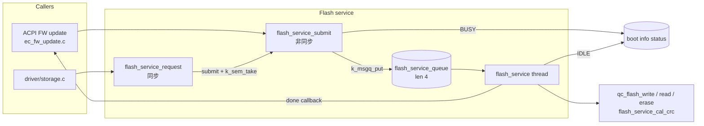

# Flash service

中文 | [English](readme_en.md)

Bootloader 專用的 flash 操作 service。由單一 thread 依序執行 write / read / erase / CRC / load-to-RAM，
確保 flash 存取不會同時發生。提供兩種呼叫方式：
- `flash_service_submit()`：非同步，放進佇列後立即返回，完成時呼叫 callback。ACPI FW update 命令使用。
- `flash_service_request()`：同步，等到完成才返回。開機時的 image 載入 / 驗證 (`driver/storage.c`) 使用。

只在 `CONFIG_APP_BOOTLOADER=y` 時編入，沒有獨立的 Kconfig 與 shell。

## Architecture


### 流程
1. `flash_service_submit()` 檢查呼叫端打包好的 `flash_service_msg_t`，把 boot info status 設為 `EC_STATE_BUSY`，把 msg 複製進佇列
   (`K_NO_WAIT`，滿了回傳 `-ENOMEM`) 後立即返回，呼叫端的 msg 可以放在 stack。
2. Thread (stack 1024，priority 5) 依序執行，完成後先呼叫 `done` callback (例如寫入 CRC 結果)，
   再更新 status：佇列中的請求全部完成後設為 `EC_STATE_BOOTLOADER_IDLE_WP_OFF`，
   即使有失敗也一樣回到 IDLE，失敗只印 log 並傳給 `done` callback (目前不回報 `EC_STATE_SPI_OP_FAILED`)。
3. Host 以 ACPI `0xEC` poll status，等到 idle 才進行下一步。
4. `flash_service_request()` 以 submit 加上 stack 上的 semaphore 實作，等 callback give 後返回結果。

不可在 flash service thread 內 (包含 `done` callback) 呼叫 `flash_service_request()`，否則會 deadlock。

## API
[interface/flash_service.h](../../interface/flash_service.h)

```c
typedef struct flash_service_msg_t {
    flash_service_command_t command;
    off_t flash_address;
    size_t size;
    void *ram_address;             // LOAD_TO_RAM destination
    void *data_pointer;            // WRITE source / READ destination
    flash_service_done_cb_t done;  // async completion callback, may be NULL
    void *user_data;               // passed to done
} flash_service_msg_t;

int flash_service_submit(const flash_service_msg_t *msg);
int flash_service_request(const flash_service_msg_t *msg, uint32_t *crc_result);
bool flash_service_busy(void);
```

| Command | 必要參數 | 說明 |
| --- | --- | --- |
| `FLASH_SERVICE_WRITE` | `data_pointer` | 從 `data_pointer` 寫入 flash |
| `FLASH_SERVICE_READ` | `data_pointer` | 讀出到 `data_pointer` |
| `FLASH_SERVICE_ERASE` | - | 抹除 `flash_address` 起 `size` bytes |
| `FLASH_SERVICE_CRC` | - (結果：同步為 `crc_result`，非同步為 callback 的 `crc`) | 計算 CRC8 (結果存於 4 byte，高 3 byte 為 0) |
| `FLASH_SERVICE_LOAD_TO_RAM` | `ram_address` | 讀出到 `ram_address` |

所有命令都需要 `flash_address >= 0` 且 `size > 0`，否則回傳 `-EINVAL`。
非同步呼叫時 `data_pointer` / `ram_address` 必須保持有效直到 callback 被呼叫 (或 status 不再是 busy)。

## 使用範例
```c
// 非同步：立即返回，結果在 callback (flash service thread) 中處理
static void crc_done(flash_service_command_t cmd, int result, uint32_t crc, void *user) {
    // 寫入 boot info，status 在 callback 之後才離開 BUSY
}
flash_service_msg_t msg = {
    .command = FLASH_SERVICE_CRC,
    .flash_address = IMG_ADDR,
    .size = hdr.fw_size,
    .done = crc_done,
};
flash_service_submit(&msg);   // msg 會被複製進佇列，可放在 stack

// 同步：等到完成 (done / user_data 會被忽略)
uint32_t crc;
int ret = flash_service_request(&msg, &crc);
```

## Test
Flash service 沒有 shell，透過 bootloader 的 ACPI FW update 命令驗證，見 [ACPI service](../acpi/readme.md) 的 Bootloader 命令表：

```shell
uart:~$ acpi write 0xBB 0x01 0xF0
ACPI CMD written successfully
<inf> acpi: Run CRC: Size=..., Calculated 0x........, Expected 0x........

uart:~$ acpi write 0xA2
ACPI CMD written successfully
<inf> acpi: Read CRC: Status=0xAC, CRC=0x........
```
