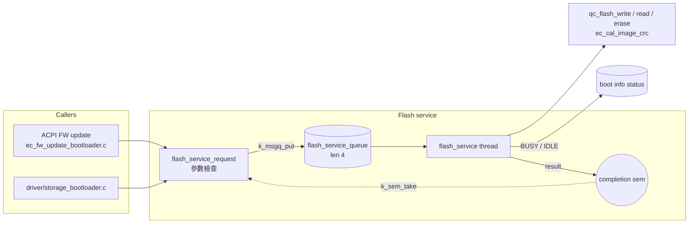

# Flash service

中文 | [English](readme_en.md)

Bootloader 專用的 flash 操作 service。呼叫端以 `flash_service_request()` 送出請求，
由單一 thread 依序執行 write / read / erase / CRC / load-to-RAM，確保 flash 存取不會同時發生。
只在 `CONFIG_APP_BOOTLOADER=y` 時編入，沒有獨立的 Kconfig 與 shell。

## Architecture


### 流程
1. `flash_service_request()` 檢查參數，建立 stack 上的 semaphore，把請求放進佇列。
2. Thread (stack 1024，priority 5) 取出請求，執行期間將 boot info status 設為 `EC_STATE_BUSY`，
   完成後設為 `EC_STATE_BOOTLOADER_IDLE_WP_OFF` (Host 可用 ACPI `0xEC` 查詢)。
3. 結果寫回後 give semaphore，呼叫端返回 (同步呼叫，`K_FOREVER` 等待)。

不可在 flash service thread 內呼叫 `flash_service_request()`，否則會 deadlock。

## API
[interface/flash_service.h](../../interface/flash_service.h)

```c
int flash_service_request(flash_service_command_t command,
                          off_t flash_address, size_t size,
                          void *ram_address, void *data_pointer,
                          uint32_t *crc_result);
```

| Command | 必要參數 | 說明 |
| --- | --- | --- |
| `FLASH_SERVICE_WRITE` | `data_pointer` | 從 `data_pointer` 寫入 flash |
| `FLASH_SERVICE_READ` | `data_pointer` | 讀出到 `data_pointer` |
| `FLASH_SERVICE_ERASE` | - | 抹除 `flash_address` 起 `size` bytes |
| `FLASH_SERVICE_CRC` | `crc_result` | 計算 CRC32 |
| `FLASH_SERVICE_LOAD_TO_RAM` | `ram_address` | 讀出到 `ram_address` |

所有命令都需要 `flash_address >= 0` 且 `size > 0`，否則回傳 `-EINVAL`。成功回傳 0，失敗回傳 driver 的錯誤碼。

## 使用範例
```c
uint32_t crc;
int ret = flash_service_request(FLASH_SERVICE_CRC, IMG_ADDR, hdr.fw_size,
                                NULL, NULL, &crc);
```

## Test
Flash service 沒有 shell，透過 bootloader 的 ACPI FW update 命令驗證，見 [ACPI service](../acpi/readme.md) 的 Bootloader 命令表：

```shell
uart:~$ acpi write 0xBB 0x01 0xF0
ACPI CMD written successfully
<inf> acpi: Run CRC: Size=..., Calculated 0x........, Expected 0x........

uart:~$ acpi write 0xA2
ACPI CMD written successfully
<inf> acpi: Read CRC: Status=0xAC, CRC=0x........
```
