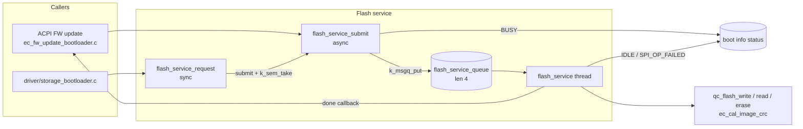

# Flash service

[中文](readme.md) | English

Bootloader-only flash operation service. A single thread runs write / read / erase / CRC /
load-to-RAM in order, so flash accesses never overlap. Two ways to call it:
- `flash_service_submit()`: asynchronous, returns as soon as the request is queued and calls a
  callback when done. Used by the ACPI FW update commands.
- `flash_service_request()`: synchronous, returns when the operation is done. Used by the boot-time
  image load / validation (`driver/storage_bootloader.c`).

Built only with `CONFIG_APP_BOOTLOADER=y`; there is no separate Kconfig or shell.

## Architecture


### Flow
1. `flash_service_submit()` checks the arguments, sets the boot info status to `EC_STATE_BUSY`,
   queues the request (`K_NO_WAIT`, `-ENOMEM` when full) and returns. The request holds no pointer
   into the caller's stack.
2. The thread (stack 1024, priority 5) runs the requests in order. After each one it calls the `done`
   callback first (e.g. to store a CRC result), then updates the status: once every queued request
   has finished it is `EC_STATE_BOOTLOADER_IDLE_WP_OFF`, or `EC_STATE_SPI_OP_FAILED` if one of them
   failed (cleared by the next submit).
3. The host polls the status with ACPI `0xEC` and waits for idle before the next step.
4. `flash_service_request()` is built on submit plus a semaphore on the caller's stack; it returns the
   result once the callback gives the semaphore.

Do not call `flash_service_request()` from the flash service thread itself (including a `done`
callback); it would deadlock.

## API
[interface/flash_service.h](../../interface/flash_service.h)

```c
typedef void (*flash_service_done_cb_t)(flash_service_command_t command,
                                        int result, uint32_t crc,
                                        void *user_data);

int flash_service_submit(flash_service_command_t command, off_t flash_address,
                         size_t size, void *ram_address, void *data_pointer,
                         flash_service_done_cb_t done, void *user_data);

int flash_service_request(flash_service_command_t command,
                          off_t flash_address, size_t size,
                          void *ram_address, void *data_pointer,
                          uint32_t *crc_result);

bool flash_service_busy(void);
```

| Command | Required argument | Description |
| --- | --- | --- |
| `FLASH_SERVICE_WRITE` | `data_pointer` | Write flash from `data_pointer` |
| `FLASH_SERVICE_READ` | `data_pointer` | Read into `data_pointer` |
| `FLASH_SERVICE_ERASE` | - | Erase `size` bytes starting at `flash_address` |
| `FLASH_SERVICE_CRC` | `crc_result` (sync) / callback `crc` (async) | Compute CRC8 (stored in 4 bytes, upper 3 bytes are 0) |
| `FLASH_SERVICE_LOAD_TO_RAM` | `ram_address` | Read into `ram_address` |

Every command requires `flash_address >= 0` and `size > 0`, otherwise it returns `-EINVAL`. For an
asynchronous call, `data_pointer` / `ram_address` must stay valid until the callback runs (or the status
is no longer busy).

## Example
```c
// Async: returns at once, the result is handled in the callback (flash service thread)
static void crc_done(flash_service_command_t cmd, int result, uint32_t crc, void *user) {
    // store into boot info; the status leaves BUSY only after the callback
}
flash_service_submit(FLASH_SERVICE_CRC, IMG_ADDR, hdr.fw_size, NULL, NULL, crc_done, NULL);

// Sync: waits until done
uint32_t crc;
int ret = flash_service_request(FLASH_SERVICE_CRC, IMG_ADDR, hdr.fw_size,
                                NULL, NULL, &crc);
```

## Test
The flash service has no shell. Verify it through the bootloader's ACPI FW update commands; see the
Bootloader command table in the [ACPI service](../acpi/readme_en.md):

```shell
uart:~$ acpi write 0xBB 0x01 0xF0
ACPI CMD written successfully
<inf> acpi: Run CRC: Size=..., Calculated 0x........, Expected 0x........

uart:~$ acpi write 0xA2
ACPI CMD written successfully
<inf> acpi: Read CRC: Status=0xAC, CRC=0x........
```
