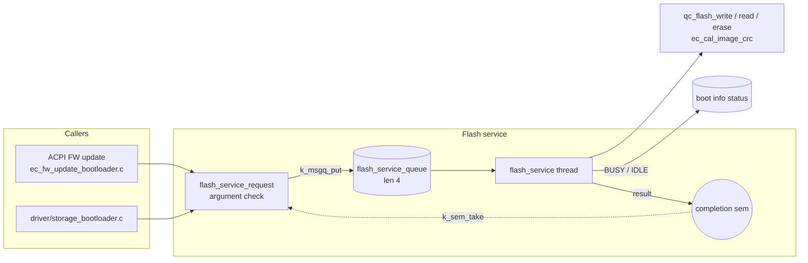

# Flash service

[中文](readme.md) | English

Bootloader-only flash operation service. Callers submit requests with `flash_service_request()`, and a
single thread runs write / read / erase / CRC / load-to-RAM in order, so flash accesses never overlap.
Built only when `CONFIG_APP_BOOTLOADER=y`; it has no Kconfig of its own and no shell.

## Architecture


### Flow
1. `flash_service_request()` checks the arguments, creates a semaphore on the caller's stack, and
   queues the request.
2. The thread (stack 1024, priority 5) takes the request and sets the boot info status to
   `EC_STATE_BUSY` while it runs, then to `EC_STATE_BOOTLOADER_IDLE_WP_OFF` when done (the host can
   query this with ACPI `0xEC`).
3. It writes back the result and gives the semaphore, and the caller returns (the call is synchronous
   and waits with `K_FOREVER`).

Do not call `flash_service_request()` from the flash service thread itself; it would deadlock.

## API
[interface/flash_service.h](../../interface/flash_service.h)

```c
int flash_service_request(flash_service_command_t command,
                          off_t flash_address, size_t size,
                          void *ram_address, void *data_pointer,
                          uint32_t *crc_result);
```

| Command | Required argument | Description |
| --- | --- | --- |
| `FLASH_SERVICE_WRITE` | `data_pointer` | Write flash from `data_pointer` |
| `FLASH_SERVICE_READ` | `data_pointer` | Read into `data_pointer` |
| `FLASH_SERVICE_ERASE` | - | Erase `size` bytes starting at `flash_address` |
| `FLASH_SERVICE_CRC` | `crc_result` | Compute CRC32 |
| `FLASH_SERVICE_LOAD_TO_RAM` | `ram_address` | Read into `ram_address` |

Every command requires `flash_address >= 0` and `size > 0`, otherwise it returns `-EINVAL`. Returns 0 on
success, or the driver's error code on failure.

## Example
```c
uint32_t crc;
int ret = flash_service_request(FLASH_SERVICE_CRC, IMG_ADDR, hdr.fw_size,
                                NULL, NULL, &crc);
```

## Test
The flash service has no shell. Verify it through the bootloader's ACPI FW update commands; see the
Bootloader command table in the [ACPI service](../acpi/readme_en.md):

```shell
uart:~$ acpi write 0xBB 0x01 0xF0
ACPI CMD written successfully
<inf> acpi: Run CRC: Size=..., Calculated 0x........, Expected 0x........

uart:~$ acpi write 0xA2
ACPI CMD written successfully
<inf> acpi: Read CRC: Status=0xAC, CRC=0x........
```
