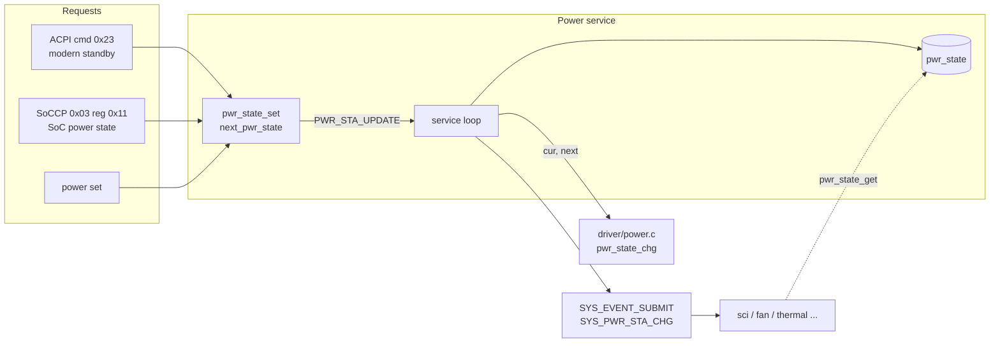

# Power service

中文 | [English](readme_en.md)

維護系統 power state。收到切換要求後由 service thread 呼叫平台相關的 `pwr_state_chg()` 執行切換，
完成後送出系統事件 `SYS_PWR_STA_CHG` 通知所有訂閱的 service。僅編入 app。

## Kconfig
| Option | Default | 說明 |
| --- | --- | --- |
| `CONFIG_POWER_SERVICE` | y | 啟用 Power service |
| `CONFIG_POWER_LOG_LEVEL` | - | log level |
| `CONFIG_POWER_SHELL` | y (需 `SHELL`) | `power` shell 命令 |

## Architecture


### 流程
1. `pwr_state_set(state)`：檢查範圍；與目前 state 相同時只印 warning。否則記錄為 `next_pwr_state` 並通知 thread。
2. Service thread 呼叫 `pwr_state_chg(cur, next)` 執行平台流程 ([driver/power.c](../../driver/power.c))。
3. 更新 `pwr_state`，並以 `SYS_EVENT_SUBMIT(SYS_PWR_STA_CHG)` 通知所有用 `SYS_EVENT_SUBSCRIBE` 訂閱的 service。

初始 state 為 G3。

## Power state
| 值 | State |
| --- | --- |
| 1 | S0 |
| 2 | Modern Standby |
| 3 | S3 |
| 4 | S4 |
| 5 | S5 |
| 6 | G3 |

其他 service 的行為：
- SCI：只在 S0 / Modern Standby 送出 SCI，其他 state 清空佇列。
- Fan：非 S0 時把 fan constraint 設為 OFF。
- Thermal：只在 S0 取樣。

## API
[interface/power.h](../../interface/power.h)

| 函式 | 說明 |
| --- | --- |
| `int pwr_state_get(pwr_sta_t *state)` | 取得目前 power state |
| `int pwr_state_set(pwr_sta_t state)` | 要求切換 power state (非同步) |
| `int pwr_state_chg(pwr_sta_t cur, pwr_sta_t next)` | 平台實作的切換流程 (driver 提供) |

## ACPI 命令
| Opcode | 名稱 | cmd | resp |
| --- | --- | --- | --- |
| 0x23 | SoC to EC modern standby notify | `23 status` | - |

`status` 非 0 切到 Modern Standby，0 切回 S0。

## Shell
| 命令 | 說明 |
| --- | --- |
| `power get` | 顯示目前 power state |
| `power set <1~6>` | 切換 power state |

## Test
```shell
uart:~$ power get
Current power state: G3 (6)

uart:~$ power set 1
Power state set to: S0 (1)
<inf> power: Prepare to change power state: G3 -> S0
<inf> power: Power state: S0

uart:~$ acpi write 0x23 0x01
ACPI CMD written successfully
<inf> power: Prepare to change power state: S0 -> Modern Standby
<inf> power: Power state: Modern Standby
```
