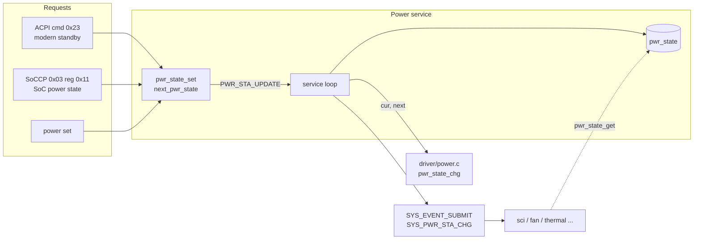

# Power service

[中文](readme.md) | English

Tracks the system power state. On a change request, the service thread calls the platform-specific
`pwr_state_chg()` to perform the transition, then submits the system event `SYS_PWR_STA_CHG` to every
subscribed service. App only.

## Kconfig
| Option | Default | Description |
| --- | --- | --- |
| `CONFIG_POWER_SERVICE` | y | Enable the Power service |
| `CONFIG_POWER_LOG_LEVEL` | - | Log level |
| `CONFIG_POWER_SHELL` | y (requires `SHELL`) | `power` shell commands |

## Architecture


### Flow
1. `pwr_state_set(state)`: checks the range; if the state equals the current one, it only logs a
   warning. Otherwise it stores it as `next_pwr_state` and notifies the thread.
2. The service thread calls `pwr_state_chg(cur, next)` to run the platform sequence
   ([driver/power.c](../../driver/power.c)).
3. It updates `pwr_state` and calls `SYS_EVENT_SUBMIT(SYS_PWR_STA_CHG)` to notify every service that
   subscribed with `SYS_EVENT_SUBSCRIBE`.

The initial state is G3.

## Power states
| Value | State |
| --- | --- |
| 1 | S0 |
| 2 | Modern Standby |
| 3 | S3 |
| 4 | S4 |
| 5 | S5 |
| 6 | G3 |

How other services react:
- SCI: sends SCIs only in S0 / Modern Standby; flushes the queue in other states.
- Fan: sets the fan constraint to OFF outside S0.
- Thermal: samples only in S0.

## API
[interface/power.h](../../interface/power.h)

| Function | Description |
| --- | --- |
| `int pwr_state_get(pwr_sta_t *state)` | Get the current power state |
| `int pwr_state_set(pwr_sta_t state)` | Request a power state change (asynchronous) |
| `int pwr_state_chg(pwr_sta_t cur, pwr_sta_t next)` | Platform transition sequence (provided by the driver) |

## ACPI commands
| Opcode | Name | cmd | resp |
| --- | --- | --- | --- |
| 0x23 | SoC to EC modern standby notify | `23 status` | - |

A non-zero `status` switches to Modern Standby; 0 switches back to S0.

## Shell
| Command | Description |
| --- | --- |
| `power get` | Show the current power state |
| `power set <1~6>` | Change the power state |

## Test
```shell
uart:~$ power get
Current power state: G3 (6)

uart:~$ power set 1
Power state set to: S0 (1)
<inf> power: Prepare to change power state: G3 -> S0
<inf> power: Power state: S0

uart:~$ acpi write 0x23 0x01
ACPI CMD written successfully
<inf> power: Prepare to change power state: S0 -> Modern Standby
<inf> power: Power state: Modern Standby
```
