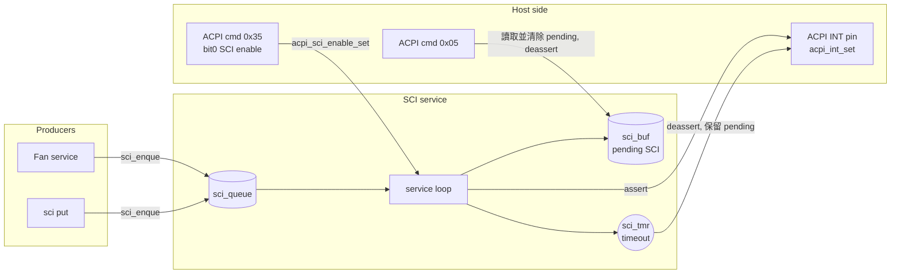

# SCI service

中文 | [English](readme_en.md)

管理送給 Host 的 SCI (System Control Interrupt) 事件：其他 service 呼叫 `sci_enque()` 排入佇列，
SCI service 一次拉起一個事件的 ACPI interrupt line，Host 以 ACPI 命令 `0x05` 讀取後再處理下一個。
僅編入 app，沒有獨立的 enable option。

## Kconfig
| Option | Default | 說明 |
| --- | --- | --- |
| `CONFIG_ACPI_SCI_QUEUE_LEN` | 16 (1 ~ 64) | 佇列長度，滿了之後新的事件會被丟棄 |
| `CONFIG_ACPI_SCI_TIMEOUT_MS` | 100 (1 ~ 10000) | 拉起 interrupt 後等待 Host 讀取的時間 |
| `CONFIG_SCI_LOG_LEVEL` | - | log level |
| `CONFIG_SCI_SHELL` | y (需 `SHELL`) | `sci` shell 命令 |

## Architecture


### 流程
1. `sci_enque(sci)`：SCI 停用或 power state 不是 S0 / Modern Standby 時直接丟棄 (回傳 0)；
   否則放進佇列並通知 service。佇列滿時回傳 `-ENOMSG`。
2. Service 在沒有 pending SCI 時從佇列取出一個放到 `sci_buf`，拉起 ACPI interrupt，並啟動 timeout timer。
3. Host 送出 `0x05` 時回傳 `sci_buf` 並清除，放下 interrupt，接著送出下一個 SCI。
4. Timeout：放下 interrupt，但 **保留** pending SCI，等 Host 之後再讀。
5. SCI 被停用 (`0x35` bit0 = 0) 或 power state 離開 S0 / MS 時，清空 pending 與佇列，並放下 interrupt。

## API
[interface/sci.h](../../interface/sci.h)

| 函式 | 說明 |
| --- | --- |
| `int sci_enque(sci_t sci)` | 排入一個 SCI 事件 |
| `int acpi_sci_enable_set(bool en)` | 啟用/停用 SCI 通知 |
| `int acpi_sci_enable_get(bool *en)` | 取得 SCI 是否啟用 |

## SCI 列表
| SCI | 說明 | 來源 |
| --- | --- | --- |
| `0x30` / `0x31` | Fan1 / Fan2 狀態改變 | fan |
| `0x32` / `0x33` | Fan1 / Fan2 RPM 超出 trip point | fan |
| `0x34` | LUT 被設定 | fan |
| `0x35` | Fan profile 切換 | fan |
| `0x36` ~ `0x38` | EC thermistor 1 ~ 3 超出門檻 | 預留，尚未使用 |
| `0x3D` | EC reset | 預留，尚未使用 |

## ACPI 命令
| Opcode | 名稱 | cmd | resp |
| --- | --- | --- | --- |
| 0x05 | Active cooling SCI event | `05` | `sci` (`00` 表示沒有 pending) |

SCI 開關由 `0x35` EC function flags 的 bit0 控制，見 [ACPI service](../acpi/readme.md)。

## Shell
| 命令 | 說明 |
| --- | --- |
| `sci en <0\|1>` | 啟用/停用 SCI |
| `sci put <hex>` | 排入一個 SCI |
| `sci get` | 讀取並清除 pending SCI (等同 Host 送 `0x05`) |
| `sci sta` | 顯示 enable、power state、pending、佇列與 timeout |

## Test
```shell
uart:~$ power set 1
uart:~$ sci put 34
SCI 0x34 submitted (pending 0x34, 0 queued)
<inf> sci: Notify SCI 0x34 (0 queued)
<wrn> sci: SCI 0x34 notification timeout; retaining pending event

uart:~$ sci sta
SCI enable  : 1
Power state : 1 (allow: 1)
Pending SCI : 0x34
Queued      : 0/16
Timeout     : 100 ms

uart:~$ sci get
SCI Enable Status: 1
Retrieved SCI Value: 0x34

uart:~$ sci en 0
SCI functionality disabled
```
