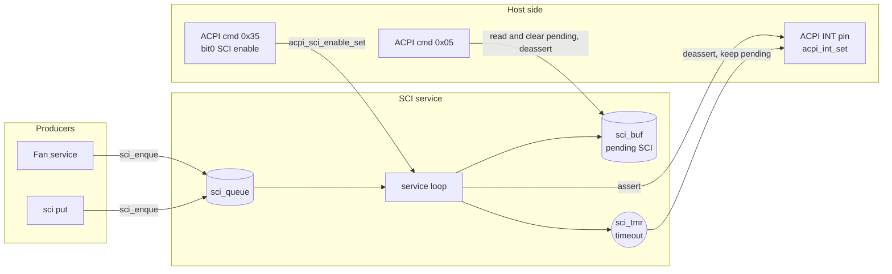

# SCI service

[中文](readme.md) | English

Manages SCI (System Control Interrupt) events sent to the host. Other services queue events with
`sci_enque()`; the SCI service asserts the ACPI interrupt line for one event at a time, and moves on to
the next one after the host reads it with ACPI command `0x05`. App only, with no separate enable option.

## Kconfig
| Option | Default | Description |
| --- | --- | --- |
| `CONFIG_ACPI_SCI_QUEUE_LEN` | 16 (1 ~ 64) | Queue length; new events are dropped once it is full |
| `CONFIG_ACPI_SCI_TIMEOUT_MS` | 100 (1 ~ 10000) | Time the host has to read the event after the interrupt is asserted |
| `CONFIG_SCI_LOG_LEVEL` | - | Log level |
| `CONFIG_SCI_SHELL` | y (requires `SHELL`) | `sci` shell commands |

## Architecture


### Flow
1. `sci_enque(sci)`: when SCI is disabled or the power state is not S0 / Modern Standby, the event is
   dropped (returns 0). Otherwise it is queued and the service is notified. Returns `-ENOMSG` if the
   queue is full.
2. When nothing is pending, the service takes one event from the queue into `sci_buf`, asserts the ACPI
   interrupt, and starts the timeout timer.
3. When the host sends `0x05`, `sci_buf` is returned and cleared, the interrupt is deasserted, and the
   next SCI is sent.
4. On timeout, the interrupt is deasserted but the pending SCI is **kept** for a later host read.
5. When SCI is disabled (`0x35` bit0 = 0) or the power state leaves S0 / MS, the pending event and the
   queue are flushed and the interrupt is deasserted.

## API
[interface/sci.h](../../interface/sci.h)

| Function | Description |
| --- | --- |
| `int sci_enque(sci_t sci)` | Queue an SCI event |
| `int acpi_sci_enable_set(bool en)` | Enable/disable SCI notifications |
| `int acpi_sci_enable_get(bool *en)` | Get whether SCI is enabled |

## SCI list
| SCI | Description | Source |
| --- | --- | --- |
| `0x30` / `0x31` | Fan1 / Fan2 state changed | fan |
| `0x32` / `0x33` | Fan1 / Fan2 RPM outside the trip range | fan |
| `0x34` | LUT set | fan |
| `0x35` | Fan profile switched | fan |
| `0x36` ~ `0x38` | EC thermistor 1 ~ 3 threshold crossed | reserved, not used yet |
| `0x3D` | EC reset | reserved, not used yet |

## ACPI commands
| Opcode | Name | cmd | resp |
| --- | --- | --- | --- |
| 0x05 | Active cooling SCI event | `05` | `sci` (`00` means nothing pending) |

SCI is switched on and off by bit0 of the `0x35` EC function flags; see the [ACPI service](../acpi/readme_en.md).

## Shell
| Command | Description |
| --- | --- |
| `sci en <0\|1>` | Enable/disable SCI |
| `sci put <hex>` | Queue an SCI |
| `sci get` | Read and clear the pending SCI (same as the host sending `0x05`) |
| `sci sta` | Show enable, power state, pending, queue and timeout |

## Test
```shell
uart:~$ power set 1
uart:~$ sci put 34
SCI 0x34 submitted (pending 0x34, 0 queued)
<inf> sci: Notify SCI 0x34 (0 queued)
<wrn> sci: SCI 0x34 notification timeout; retaining pending event

uart:~$ sci sta
SCI enable  : 1
Power state : 1 (allow: 1)
Pending SCI : 0x34
Queued      : 0/16
Timeout     : 100 ms

uart:~$ sci get
SCI Enable Status: 1
Retrieved SCI Value: 0x34

uart:~$ sci en 0
SCI functionality disabled
```
