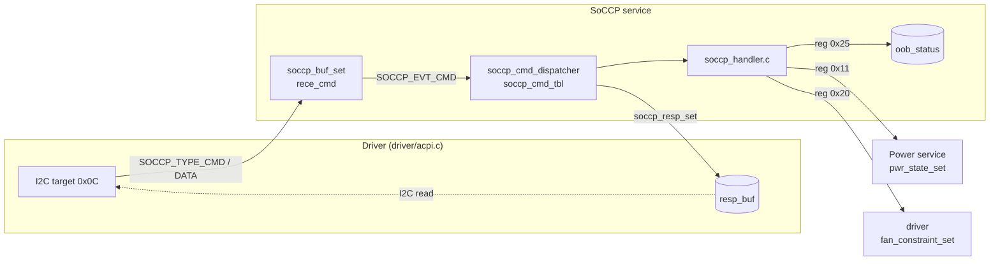

# SoCCP service

中文 | [English](readme_en.md)

處理 SoC-CP (SoC Control Processor) 經 I2C target (位址 `0x0C`) 送來的命令，
包含 who-am-i 與 power state feature (SoC power state、fan constraint、Off mode / OOB 狀態)。
與 ACPI 共用同一個 I2C controller 與 response buffer，由 [driver/acpi.c](../../driver/acpi.c) 依位址分流。僅編入 app。

## Kconfig
| Option | Default | 說明 |
| --- | --- | --- |
| `CONFIG_SOCCP_SERVICE` | y | 啟用 SoCCP service |
| `CONFIG_SOCCP_LOG_LEVEL` | - | log level |
| `CONFIG_SOCCP_SHELL` | y (需 `SHELL`) | `soccp` shell 命令 |

Buffer 大小：`SOCCP_RECE_LEN` / `SOCCP_RESP_LEN` 皆為 8 ([interface/soccp.h](../../interface/soccp.h))。

## Architecture


### 流程
1. 每收到一個 byte (`SOCCP_TYPE_CMD` 重設 index) 就存入 `rece_cmd` 並通知 service。
2. Dispatcher 依 `soccp_cmd_tbl` 比對 opcode，當收到的長度 **剛好等於** `mand` 或 `mand + opt` 時呼叫 handler。
   SoCCP 不依賴 I2C stop 觸發。
3. 有 response 的命令 (`resp_len > 0`) 以 `soccp_resp_set` 寫回；write-only 命令不動 response buffer。

新增命令：在 [soccp_handler.h](soccp_handler.h) 定義 opcode 與 handler，並加入 [service.c](service.c) 的 `soccp_cmd_tbl`。

## 命令
| Opcode | 名稱 | cmd | resp |
| --- | --- | --- | --- |
| 0x43 | Who-am-i | `43` | `05` |
| 0x03 | Power state feature | `03 reg dataL dataH` | - |

0x03 的 register：
| Reg | 名稱 | data |
| --- | --- | --- |
| `0x11` | SoC power state | `1` ~ `6` 對應 S0 / MS / S3 / S4 / S5 / G3，呼叫 `pwr_state_set` |
| `0x20` | Fan constraints | `0` fan 保持 OFF、`1` fan 可以開啟，呼叫 `fan_constraint_set` |
| `0x25` | Off mode / OOB state | bit0 SoC 在 Off-mode、bit1 SoCCP active (應永遠為 1)、bit2 OOB initialized；bit3 ~ 7 保留 (會被清掉) |

OOB 狀態常見組合：S0 + OOB `0x06`、S4/S5 + OOB `0x07`、S0 `0x02`、S4/S5 `0x03`。

注意：Fan service 在 S0 時會把 fan constraint 設回 ON、非 S0 時設為 OFF，
因此 reg `0x20` 的設定可能在下一次 fan loop 被覆蓋，見 [fan service](../fan/readme.md)。

## Shell
| 命令 | 說明 |
| --- | --- |
| `soccp write <op> [data ...]` | 以 hex 模擬 SoC-CP 寫入命令 |
| `soccp state` | 顯示最近一次的 Off mode / OOB 狀態 |

## Test
```shell
uart:~$ soccp write 43
SoCCP CMD written successfully
<inf> soccp: SoCCP Who-Am-I called, returning 0x05

uart:~$ soccp write 03 25 06 00
SoCCP CMD written successfully
uart:~$ soccp state
OffMode/OOB status: 0x0006
	Bit 0 SoC on Off-mode : 0
	Bit 1 SoCCP active    : 1
	Bit 2 OOB initialized : 1

uart:~$ soccp write 03 11 01 00
SoCCP CMD written successfully
<inf> soccp: SoCCP: SoC power state notified: 1
<inf> power: Power state: S0
```
