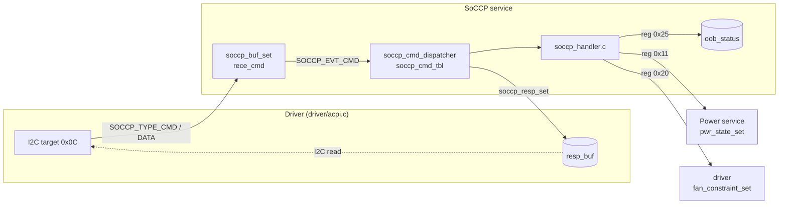

# SoCCP service

[中文](readme.md) | English

Handles commands sent by the SoC-CP (SoC Control Processor) through the I2C target (address `0x0C`):
who-am-i and the power state feature (SoC power state, fan constraint, Off mode / OOB state).
It shares the I2C controller and response buffer with ACPI; [driver/acpi.c](../../driver/acpi.c) routes
traffic by address. App only.

## Kconfig
| Option | Default | Description |
| --- | --- | --- |
| `CONFIG_SOCCP_SERVICE` | y | Enable the SoCCP service |
| `CONFIG_SOCCP_LOG_LEVEL` | - | Log level |
| `CONFIG_SOCCP_SHELL` | y (requires `SHELL`) | `soccp` shell commands |

Buffer sizes: `SOCCP_RECE_LEN` / `SOCCP_RESP_LEN` are both 8 ([interface/soccp.h](../../interface/soccp.h)).

## Architecture


### Flow
1. Every received byte is stored in `rece_cmd` (`SOCCP_TYPE_CMD` resets the index) and the service is
   notified.
2. The dispatcher matches the opcode against `soccp_cmd_tbl` and calls the handler when the received
   length **exactly equals** `mand` or `mand + opt`. SoCCP does not rely on the I2C stop.
3. Commands with a response (`resp_len > 0`) write it back with `soccp_resp_set`; write-only commands
   leave the response buffer untouched.

To add a command: define the opcode and handler in [soccp_handler.h](soccp_handler.h) and add it to
`soccp_cmd_tbl` in [service.c](service.c).

## Commands
| Opcode | Name | cmd | resp |
| --- | --- | --- | --- |
| 0x43 | Who-am-i | `43` | `05` |
| 0x03 | Power state feature | `03 reg dataL dataH` | - |

Registers of 0x03:
| Reg | Name | data |
| --- | --- | --- |
| `0x11` | SoC power state | `1` ~ `6` map to S0 / MS / S3 / S4 / S5 / G3; calls `pwr_state_set` |
| `0x20` | Fan constraints | `0` fans stay OFF, `1` fans may turn ON; calls `fan_constraint_set` |
| `0x25` | Off mode / OOB state | bit0 SoC in Off-mode, bit1 SoCCP active (should always be 1), bit2 OOB initialized; bits 3 ~ 7 reserved (cleared) |

Common OOB state values: S0 + OOB `0x06`, S4/S5 + OOB `0x07`, S0 `0x02`, S4/S5 `0x03`.

Note: the Fan service sets the fan constraint back to ON in S0 and to OFF outside S0, so a value set
through reg `0x20` can be overwritten on the next fan loop pass; see the [fan service](../fan/readme_en.md).

## Shell
| Command | Description |
| --- | --- |
| `soccp write <op> [data ...]` | Simulate a SoC-CP write in hex |
| `soccp state` | Show the latest Off mode / OOB state |

## Test
```shell
uart:~$ soccp write 43
SoCCP CMD written successfully
<inf> soccp: SoCCP Who-Am-I called, returning 0x05

uart:~$ soccp write 03 25 06 00
SoCCP CMD written successfully
uart:~$ soccp state
OffMode/OOB status: 0x0006
	Bit 0 SoC on Off-mode : 0
	Bit 1 SoCCP active    : 1
	Bit 2 OOB initialized : 1

uart:~$ soccp write 03 11 01 00
SoCCP CMD written successfully
<inf> soccp: SoCCP: SoC power state notified: 1
<inf> power: Power state: S0
```
