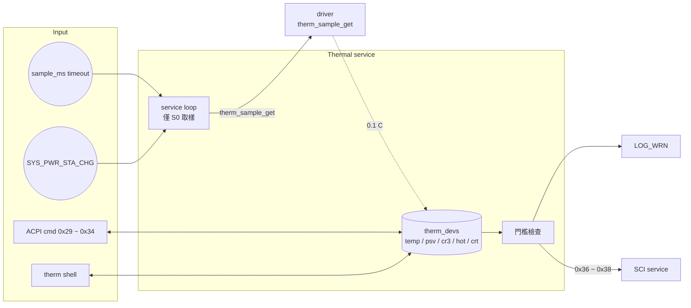

# Thermal service

中文 | [English](readme_en.md)

在 S0 時週期性讀取 EC thermistor 溫度，檢查 PSV / CR3 / HOT / CRT 門檻並送出 SCI 通知 Host，
並透過 ACPI 提供溫度、門檻與取樣週期的讀寫。僅編入 app。

## Kconfig
| Option | Default | 說明 |
| --- | --- | --- |
| `CONFIG_THERMAL_SERVICE` | y | 啟用 Thermal service |
| `CONFIG_THERMAL_LOG_LEVEL` | - | log level |
| `CONFIG_THERMAL_SHELL` | y (需 `SHELL`) | `therm` shell 命令 |

## Architecture


### Service loop
1. 等待系統事件或 `sample_ms` (預設 1000 ms) 逾時。
2. Power state 不是 S0 時停止取樣，直到下一次 power state 改變才再檢查。
3. 對 thermistor 1 ~ 3 呼叫 `therm_sample_get` 取得溫度 (0.1 °C)，存入 `therm_devs`。
4. 溫度超過 PSV / CR3 / HOT / CRT 時印出 warning，並送 SCI `0x36` / `0x37` / `0x38`
   (thermistor 1 / 2 / 3)。同時超過多個門檻也只送一次；在門檻之上期間每次取樣都會送。

門檻單位為 1 °C，預設全部為 80 °C。新的取樣週期在目前這次等待結束後生效。

## ACPI 命令
`[]` 內為 optional；帶 optional 欄位即為寫入，否則為讀取。

| Opcode | 名稱 | cmd | resp |
| --- | --- | --- | --- |
| 0x29 / 0x2A / 0x2B | Thermistor 1 / 2 / 3 溫度 | `29` | `02 tempL tempH` |
| 0x32 | Thermistor 門檻 | `32 id [04 psv cr3 hot crt]` | `04 psv cr3 hot crt` |
| 0x34 | 取樣週期 (ms) | `34 [msL msH]` | `msL msH` |

補充：
- 溫度格式：bit15 為正負號，bit0 ~ 14 為絕對值 (0.1 °C)。例：`0x00FB` = 25.1 °C、`0x8032` = -5.0 °C。
- 0x32 的 `id` 只取低 4 bits，有效值為 `1` ~ `3`。
- 0x34 寫入小於 100 ms 時以 100 ms 取代；response 沒有 byte count。

## Shell
| 命令 | 說明 |
| --- | --- |
| `therm dump` | 顯示所有 thermistor 溫度、門檻與取樣週期 |
| `therm set <id> <psv> <cr3> <hot> <crt>` | 設定門檻 (°C) |
| `therm sample <ms>` | 設定取樣週期 (shell 不檢查 100 ms 下限) |

## Test
```shell
uart:~$ therm dump
Therm ID: 1
  Temp: 35.2 deg C
  PSV : 80 deg C
  CR3 : 80 deg C
  HOT : 80 deg C
  CRT : 80 deg C
-------------------
...
Sample Rate: 1000 ms

uart:~$ therm set 1 30 40 50 60
Updated Thermal 1 thresholds
# 溫度超過門檻後每次取樣都會印出並送 SCI 0x36:
# <wrn> thermal: Thermal 1: PSV

uart:~$ therm sample 500
Thermal sample rate set to 500 ms

uart:~$ acpi write 0x32 0x01
ACPI CMD written successfully
# Host 讀回: 04 1E 28 32 3C
```
