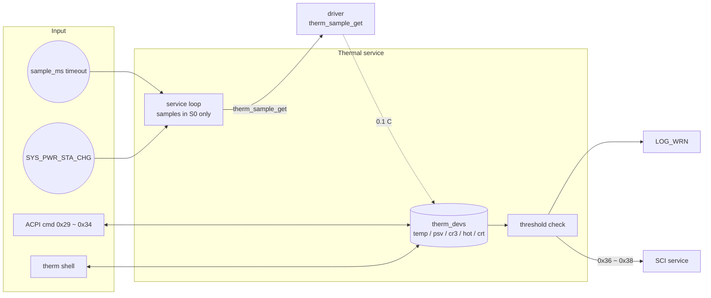

# Thermal service

[中文](readme.md) | English

Periodically samples the EC thermistors while in S0, checks the PSV / CR3 / HOT / CRT thresholds, notifies the
Host via SCI, and exposes the temperatures, thresholds and sampling period over ACPI. App only.

## Kconfig
| Option | Default | Description |
| --- | --- | --- |
| `CONFIG_THERMAL_SERVICE` | y | Enable the Thermal service |
| `CONFIG_THERMAL_LOG_LEVEL` | - | Log level |
| `CONFIG_THERMAL_SHELL` | y (requires `SHELL`) | `therm` shell commands |

## Architecture


### Service loop
1. Waits for a system event or the `sample_ms` timeout (default 1000 ms).
2. Outside S0, sampling stops until the next power state change.
3. Calls `therm_sample_get` for thermistors 1 ~ 3 and stores the temperature (0.1 °C) in `therm_devs`.
4. Logs a warning and sends SCI `0x36` / `0x37` / `0x38` (thermistor 1 / 2 / 3) when the temperature
   exceeds PSV / CR3 / HOT / CRT. Only one SCI is sent even if several thresholds are crossed; it is sent
   on every sample while the temperature stays above a threshold.

Thresholds are in 1 °C and all default to 80 °C. A new sampling period takes effect after the current
wait ends.

## ACPI commands
Fields in `[]` are optional; including them makes the command a write, otherwise it is a read.

| Opcode | Name | cmd | resp |
| --- | --- | --- | --- |
| 0x29 / 0x2A / 0x2B | Thermistor 1 / 2 / 3 temperature | `29` | `02 tempL tempH` |
| 0x32 | Thermistor thresholds | `32 id [04 psv cr3 hot crt]` | `04 psv cr3 hot crt` |
| 0x34 | Sampling period (ms) | `34 [msL msH]` | `msL msH` |

Notes:
- Temperature format: bit15 is the sign bit, bits 0 ~ 14 are the magnitude in 0.1 °C.
  E.g. `0x00FB` = 25.1 °C, `0x8032` = -5.0 °C.
- 0x32 uses only the low 4 bits of `id`; valid values are `1` ~ `3`.
- A 0x34 write below 100 ms is replaced with 100 ms; the response has no byte count.

## Shell
| Command | Description |
| --- | --- |
| `therm dump` | Show temperature and thresholds of all thermistors, plus the sampling period |
| `therm set <id> <psv> <cr3> <hot> <crt>` | Set thresholds (°C) |
| `therm sample <ms>` | Set the sampling period (the shell does not enforce the 100 ms minimum) |

## Test
```shell
uart:~$ therm dump
Therm ID: 1
  Temp: 35.2 deg C
  PSV : 80 deg C
  CR3 : 80 deg C
  HOT : 80 deg C
  CRT : 80 deg C
-------------------
...
Sample Rate: 1000 ms

uart:~$ therm set 1 30 40 50 60
Updated Thermal 1 thresholds
# Once above the threshold, every sample logs and sends SCI 0x36:
# <wrn> thermal: Thermal 1: PSV

uart:~$ therm sample 500
Thermal sample rate set to 500 ms

uart:~$ acpi write 0x32 0x01
ACPI CMD written successfully
# Host reads back: 04 1E 28 32 3C
```
